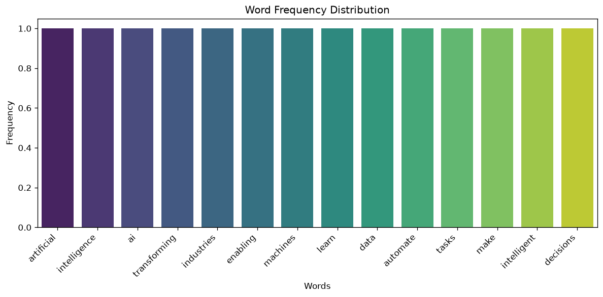
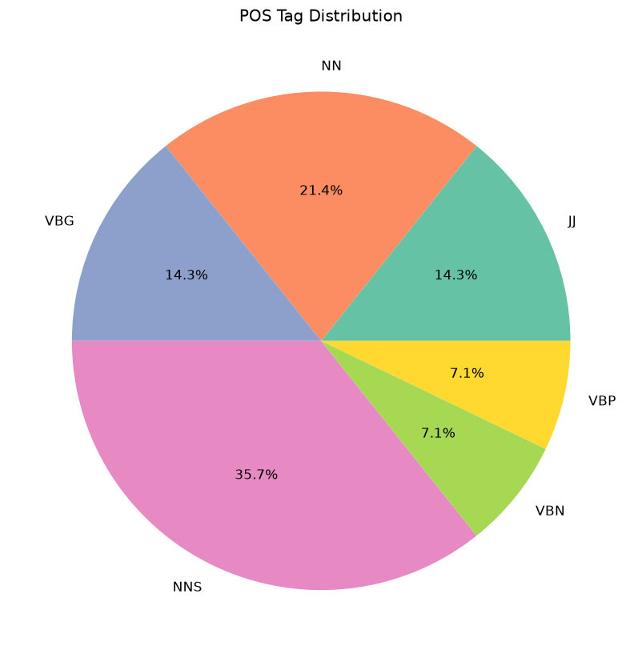
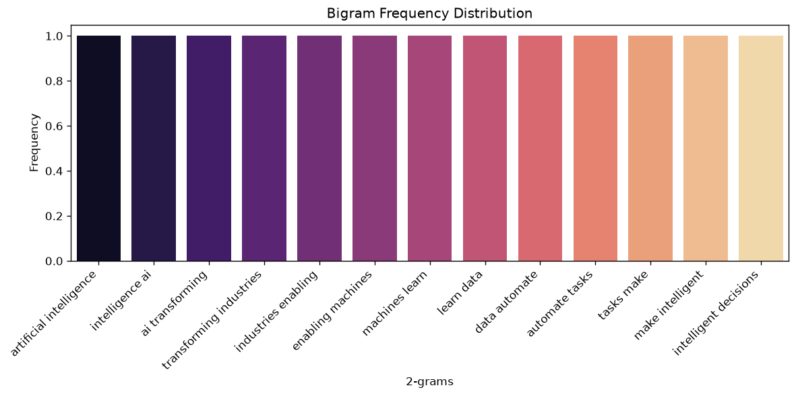
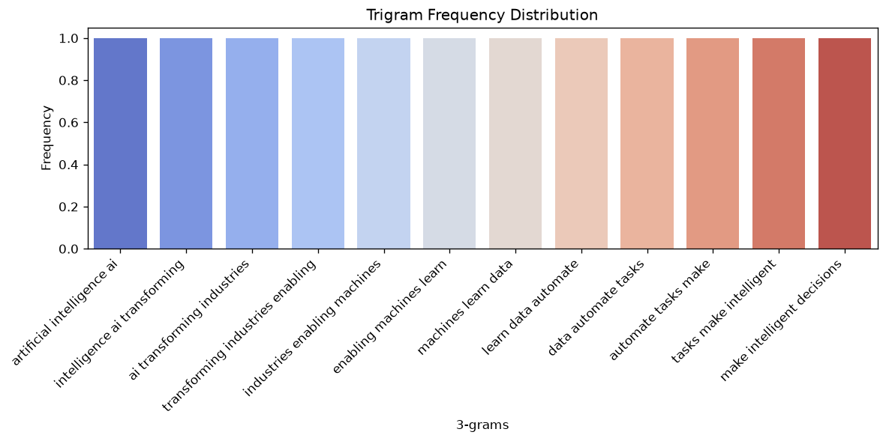
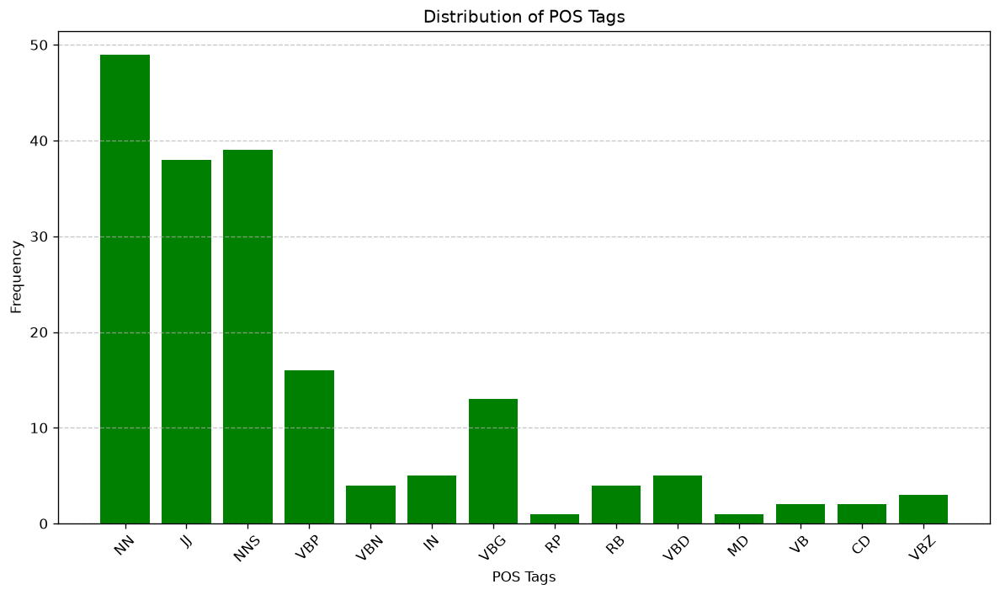
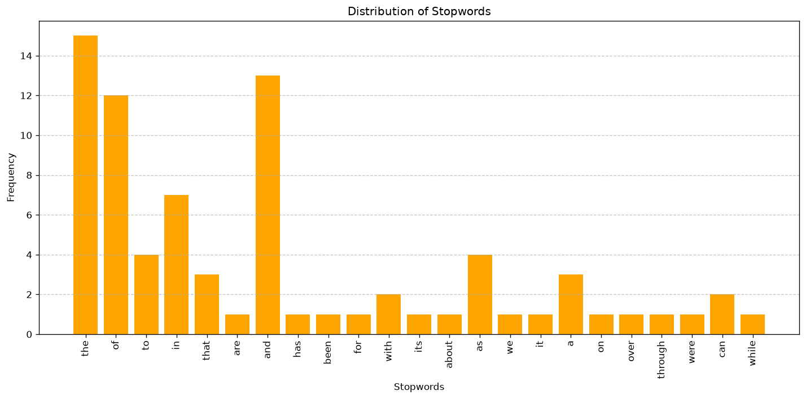
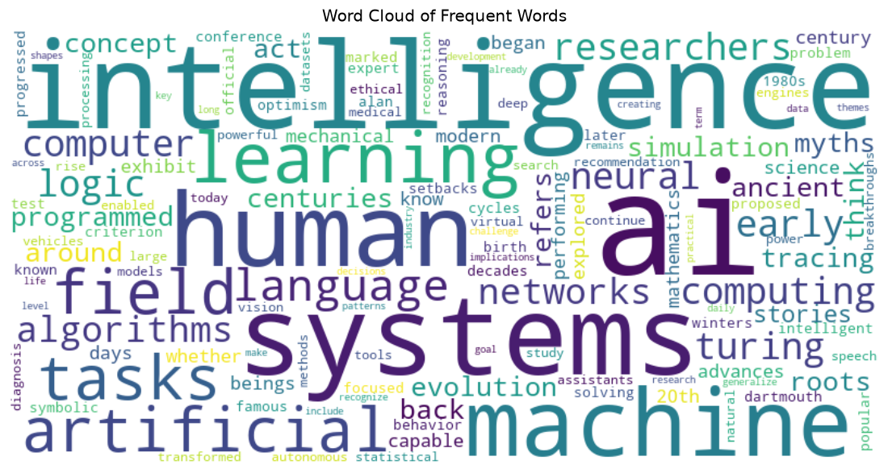

# Experiment 01 — Text Preprocessing

**Course:** PGD AI & ML (2024–25) · MIT WPU  
**Student:** Nabila Tajrin Bristy · PRN 1262243611

Fundamental NLP text preprocessing and exploratory analysis using **NLTK**.

---

## Folder structure

```text
02-text-preprocessing/
├── README.md
├── requirements.txt
├── data/
│   └── ai_sample.txt
├── images/                      # charts generated by the scripts
├── part_a_single_sentence.py
└── part_b_document_analysis.py
```

---

## Setup & run

```bash
cd 02-text-preprocessing
pip install -r requirements.txt
python part_a_single_sentence.py
python part_b_document_analysis.py
```

Charts are saved under `images/` and opened on screen.

---

## Part A — Single sentence

Pipeline: trim → lowercase → tokenize → stopwords → punctuation → stem → lemma (POS-aware) → n-grams → plots.

### Word frequency



### POS tag distribution



### Bigrams



### Trigrams



---

## Part B — Document (`data/ai_sample.txt`)

Counts unique tokens, punctuation, lemmas; plots POS tags, stopwords, word cloud; prints top-10 words.

### POS tag bars



### Stopword distribution



### Word cloud



---

## After first run — push images to GitHub (optional)

```bash
git add images/
git commit -m "Add text-preprocessing experiment charts"
git push
```

Until you push, the images above show only after you run the scripts locally (files appear in `images/`).

---

## Requirements

- Python 3.8+
- nltk, matplotlib, seaborn, wordcloud
